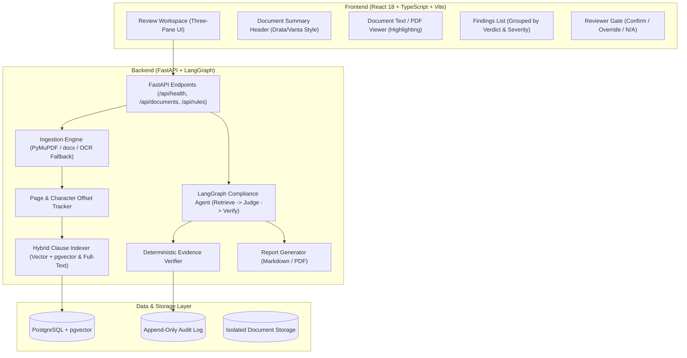

# Compliance Agent

A production-grade, AI-augmented autonomous compliance agent that analyzes policies, contracts, and agreements, extracts key clauses, evaluates them against versioned compliance rules, detects violations, and provides deterministic evidence verification for every finding.

> **Legal Disclaimer**: This software is an automated contract analysis and issue organization tool for human compliance reviewers. It does not provide legal advice or substitute for licensed legal counsel.

---

## Core Loop

$$\text{Documents} \longrightarrow \text{Rules} \longrightarrow \text{Evidence} \longrightarrow \text{Report}$$

1. **Ingest Documents**: Extract text while preserving exact page numbers and character offsets.
2. **Index & Retrieve Clauses**: Structure-aware chunking on headings/sections with hybrid retrieval (vector + full-text search).
3. **Check Rules**: LangGraph state graph evaluating each rule with structured verdicts.
4. **Verify Evidence**: Deterministic quote verification against the source document (unverified quotes are rejected).
5. **Generate Report**: Summaries by verdict, verbatim quotes, audit trail, and PDF/Markdown export.

---

## 4 Core Invariants

1. **No finding without verified evidence**: Every finding must include a verbatim quote from the document plus its page number and character offsets. A deterministic code check validates that the quote actually exists in the source text. If it does not, the finding is rejected.
2. **Three outcomes, never two**: Every rule check ends as `Compliant`, `Violation`, or `Needs human review`. Absence of a clause records the searches executed so a reviewer can inspect the trace.
3. **Rules are data, not prompts**: Rules live in a versioned table with specific types (`required_clause`, `prohibited_term`, `numeric_threshold`, `conditional`). Pre-checks use deterministic regexes where possible.
4. **Document text is untrusted input**: Document content is labeled and isolated before reaching models to defend against prompt-injection and override instructions.

---

## System Architecture



---

## Project Structure

```
Compliance Agent/
├── backend/
│   ├── app/               # FastAPI application, config, database sessions, health checks
│   ├── ingestion/         # Document parsers (PDF, DOCX, OCR fallback) with offset tracking
│   ├── indexing/          # Structure-aware chunking, embeddings, pgvector + full-text search
│   ├── rules/             # Rule schema, versioning, starter NDA library, deterministic regexes
│   ├── agent/             # LangGraph state graph: retrieve -> judge -> verify -> review interrupt
│   ├── evidence/          # Verbatim quote verification and offset resolution
│   └── reporting/         # Compliance report generators (Markdown / PDF)
├── frontend/              # React + Vite + TypeScript (Three-pane review workspace, rule library)
├── eval/                  # Evaluation datasets (CUAD-compatible, adversarial prompt injection)
├── infra/                 # Docker Compose with PostgreSQL + pgvector
├── scripts/               # Commit helpers (commit-stage.sh, commit-stage.ps1)
└── tests/                 # Unit and integration test suites
```

---

## Starter Rule Library (Commercial NDAs)

| Code | Rule Name | Type | Severity | Description |
| :--- | :--- | :--- | :--- | :--- |
| **NDA-01** | Standard Carve-outs & Exclusions | `required_clause` | HIGH | Public domain, prior possession, independent development |
| **NDA-02** | Confidentiality Term Limit | `numeric_threshold` | HIGH | Maximum duration $\le 36$ months; perpetual duration prohibited |
| **NDA-03** | Return or Destruction of Materials | `required_clause` | LOW | Certified destruction and archival IT backup carve-outs |
| **NDA-04** | Approved Governing Law & Forum | `required_clause` | MEDIUM | Delaware, New York, or England & Wales |
| **NDA-05** | Prohibition of Non-Solicitation | `prohibited_term` | CRITICAL | Non-solicitation covenants prohibited inside standard NDAs |
| **NDA-06** | Permitted Compelled Disclosures | `required_clause` | HIGH | Subpoenas/court orders permitted with prompt written notice |
| **NDA-07** | Standard of Care | `required_clause` | MEDIUM | Reasonable care; highest possible care / absolute guarantee prohibited |
| **NDA-08** | Injunctive Relief & Remedies | `required_clause` | LOW | Right to equitable remedies without posting bond |
| **NDA-09** | As-Is Information Disclaimer | `required_clause` | LOW | No implied warranties of accuracy or completeness |
| **NDA-10** | Prohibition of Non-Circumvent | `prohibited_term` | HIGH | Deal exclusivity and lock-up terms prohibited in preliminary NDAs |

---

## Quickstart & Local Setup

### 1. Database (Docker Compose)
```bash
docker compose -f infra/docker-compose.yml up -d
```

### 2. Backend
```bash
python -m venv .venv
source .venv/bin/activate  # Or on Windows: .venv\Scripts\activate
pip install -r backend/requirements.txt
uvicorn backend.app.main:app --reload --port 8000
```
Health Check: `http://localhost:8000/api/health`

### 3. Frontend
```bash
cd frontend
npm install
npm run dev
```
UI Workspace: `http://localhost:5173`

### 4. Run Tests
```bash
pytest tests/ -v
```

---


---

## Advanced Enterprise Features (Day 1)

Compliance Agent includes 5 production-grade advanced compliance features:

### 1. Automated Redlining Engine (/api/redline)
- **Word-Level Token Diffs**: Computes precise diffs between non-compliant clauses and suggested standard remediation language.
- **Rule-Specific Remediation Templates**: Pre-configured remediation clauses for perpetual obligations, non-solicitation, jurisdiction, and governing law.
- **Unified Diff & Inline Markup**: Outputs both standard unified diff (--- / +++) and inline markup formats ([-deleted-] and {+inserted+}).
- **Endpoint**:
  - GET /api/redline/{doc_id}: Retrieves all generated redlines for non-compliant findings.
  - GET /api/redline/{doc_id}/{finding_id}: Retrieves the specific redline diff for an individual finding.

### 2. Visual Document Highlighting & Jump-to-Source (/api/highlight)
- **Semantic Color Mapping**:
  - VIOLATION: High-visibility Crimson (#DC2626)
  - NEEDS_REVIEW: Warning Amber (#D97706)
  - COMPLIANT: Success Emerald (#059669)
  - NOT_APPLICABLE: Slate Gray (#64748B)
- **Page-Aware Coordinates & Text Anchoring**: Locates exact character offsets and lines across PDF and DOCX document models.
- **Endpoint**:
  - GET /api/highlight/{doc_id}: Retrieves all highlight annotations grouped by document.
  - GET /api/highlight/{doc_id}/page/{page_number}: Filters highlights for rendering the active page in a PDF viewer.

### 3. Real-Time SSE Audit Streaming (/api/stream)
- **Server-Sent Events (SSE)**: Streams compliance progress in real-time as each rule is evaluated.
- **Event Types**:
  - audit_start: Audit initialization with document metadata and rule count.
  - `rule_progress`: Dispatched after each rule check completes with current finding and pass/fail verdict.
  - audit_complete: Emits final compliance score, summary counts, and report ready signal.
- **Endpoint**:
  - GET /api/stream/audit/{doc_id}?ruleset_id=ruleset-nda-commercial

### 4. Custom Rule Studio (/api/studio)
- **Dynamic Ruleset Authoring**: Enables compliance teams to define, modify, and delete custom rulesets without code deployment.
- **JSON & YAML Importer**: Supports importing enterprise standard policy sheets directly.
- **Endpoints**:
  - POST /api/studio/rulesets: Create a new custom ruleset.
  - GET /api/studio/rulesets: List all rulesets (built-in and custom).
  - GET /api/studio/rulesets/{id}: Fetch ruleset details.
  - POST /api/studio/rulesets/{id}/rules: Append a custom rule.
  - DELETE /api/studio/rulesets/{id}/rules/{rule_id}: Remove a rule.
  - POST /api/studio/rulesets/import: Import a ruleset from JSON or YAML payload.

### 5. Cryptographic Audit Certificates (/api/certificates)
- **HMAC-SHA256 Integrity Verification**: Generates a tamper-evident digital certificate signing the document hash, audit findings, and compliance score.
- **Non-Repudiation**: Enables external legal and audit verification of compliance reports.
- **Endpoints**:
  - POST /api/certificates/{doc_id}: Issues and cryptographically signs a compliance certificate.
  - POST /api/certificates/verify: Validates whether a provided certificate payload has been altered or tampered with.

## License

MIT
